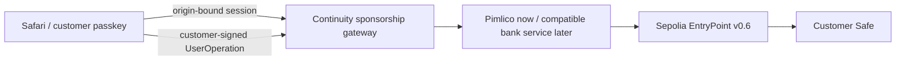

# Replaceable sponsorship service

The demo currently uses Pimlico. Swissquote is not connected and has not funded
these operations. Sponsorship buys network gas; it does not buy a customer's
assets or add a bank spending key.

The shipped login is a verified wallet passkey session, not a Swissquote customer
SSO integration. A future bank adapter can map a customer session to the proven
wallet and sponsorship entitlement at this server boundary. That integration
must preserve a separate customer approval for spending; a bank login or backend
session must never manufacture the Safe owner's signature.

The frontend knows only `/api/rpc` and `/api/sponsor`. RPC credentials, sponsorship
policy and provider endpoints are selected server-side. The gateway validates
the Sepolia bundler, v0.6 EntryPoint, session-bound sender, supported call intent,
zero native value and existing gas budget. It permits official Circle USDC
`transfer` and tutorial NFT `safeMint` to the sender. ERC-20 approvals, arbitrary
calls, the original Safe and configuration changes on the recovered acceptance
Safe are refused. The existing guarded recovery ceremony is available only for
separately allowlisted writable disposable Safes. The server overrides any
client-supplied policy. Provider errors preserve sanitized RPC/HTTP diagnostics.

## Provider contract

Keep the pinned Protocol Kit 4.1.0 / Relay Kit 3.1.0 and EntryPoint v0.6 schema.
Configure `SPONSORSHIP_PROVIDER=swissquote`, server-only
`SPONSORSHIP_BUNDLER_RPC_URL`, `SPONSORSHIP_PAYMASTER_RPC_URL` and optional
`SPONSORSHIP_POLICY_ID`. No customer code or key migration is required. The new
service or a bank-managed provider adapter must implement:

- Bundler: `eth_chainId` = 11155111, `eth_supportedEntryPoints` including v0.6,
  `eth_estimateUserOperationGas`, `eth_sendUserOperation`,
  `eth_getUserOperationReceipt`, `eth_getUserOperationByHash`.
- Paymaster: `pm_sponsorUserOperation` taking the full v0.6 operation, EntryPoint
  and optional policy object; return valid `paymasterAndData` plus positive hex
  `callGasLimit`, `verificationGasLimit`, `preVerificationGas`.
- JSON-RPC success/error envelopes; send acknowledgement is a UserOperation hash,
  never a transaction receipt. Unsupported Pimlico status queries may return
  method-not-found; receipt/by-hash checks remain authoritative.

For a non-Pimlico adapter, the gateway supplies Relay Kit's fee-price shape from
actual Sepolia RPC EIP-1559 fee estimates. It does not invent an acceptance or
receipt. The actual returned paymaster must have Sepolia code and bind to the
expected EntryPoint; the operation and fresh actual-paymaster estimate are
validated before signing. Gas fields are never changed after sponsorship/signing.

Changing the upstream alone is configuration-tested with a **synthetic** adapter,
not verified against a real Swissquote paymaster. Before a switch, review and test
the provider's authentication, policy schema, funding/deposit, supported gas
limits, quota, network, receipt behavior and denial cases. A custom service must
translate its own policy/authentication conventions to this documented boundary.
Keep credentials in a server secret manager, not in endpoint links shown to users.

## Spending authority and abuse limits

Only a human passkey approval can authorize customer spending. Backend sessions
authorize sponsorship eligibility, not custody. Default transfers are limited
to 100 test USDC by `SPONSORSHIP_MAX_USDC_UNITS` (integer units, 6 decimals).
The demo's per-instance rate limits are not a production anti-abuse system. Set
strict provider budgets now; a bank deployment needs durable customer entitlement,
usage metering, fraud controls and operational monitoring. A provider outage can
deny sponsored service; a funded customer can use other Safe tooling consistent
with the account's actual owner/module permissions.
